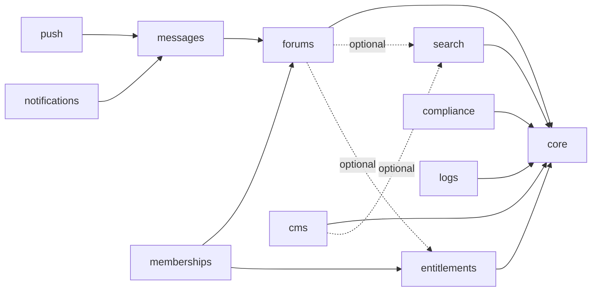

Filagora is a family of Laravel 13 / Filament 5 packages rather than one application. Each package is a Filament plugin in its own repository with its own version, config file, migrations and tests.

## Dependency graph

Dependencies are one way and mostly optional. Entitlements is usually only a `suggest`, because core's `AccessChecker` is enough. Search, push and the attachment links between forums and messages work when the other package is installed and do nothing when it is not.

Treat the graph above as the shape, not the source of truth: the exact constraints are each package's `composer.json`, and `php artisan filagora:doctor` checks the installed set.

## Layers

| Layer | Packages | Role |
| --- | --- | --- |
| Foundation | `core`, `entitlements` | Registries, settings, table and user-model resolution, access checking |
| Domain | `forums`, `cms`, `messages`, `memberships`, `plugins` | The features a site is built from |
| Cross-cutting | `search`, `push`, `notifications`, `compliance`, `logs` | Services other packages plug into without depending on them |
| Add-ons | `forum-bugreports`, `ai`, `ai-forums`, `plugins-security` | Optional extensions of a domain package |
| Profile | `zencart` | The extra columns, bindings and seeders one site needs on top of the generic packages |

## How packages find each other

A package never reaches into another's internals. It registers itself with core and uses documented contracts:

- `ModuleRegistry` records each installed package and its requirements, which `filagora:doctor` validates.
- `NavigationGroupRegistry`, `SettingsRegistry`, `ExtensionRegistry` (markdown) and `SchemaRegistry` let a package contribute to shared surfaces.
- `PrivacyContributor` and `RetentionRule` let the compliance package export, erase and prune data without knowing which packages exist.

See [Extension points]().
